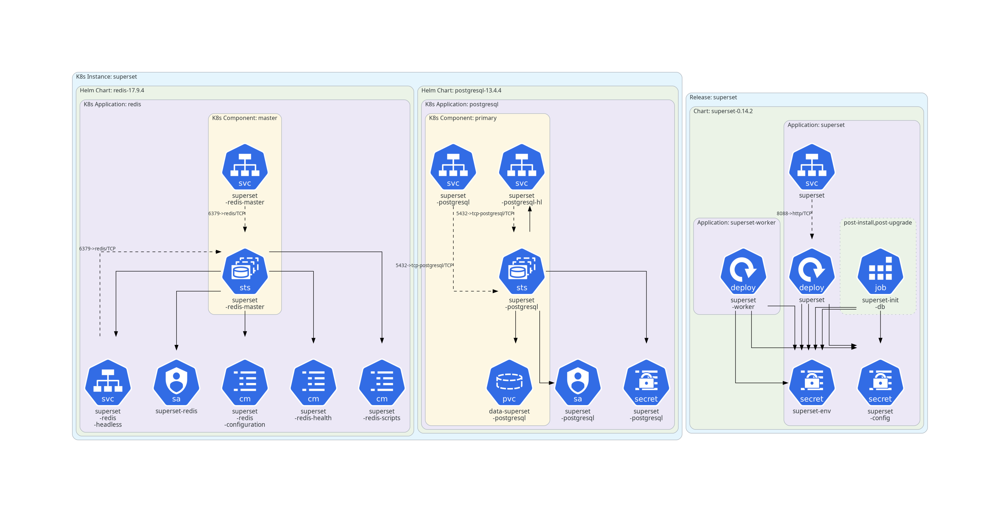
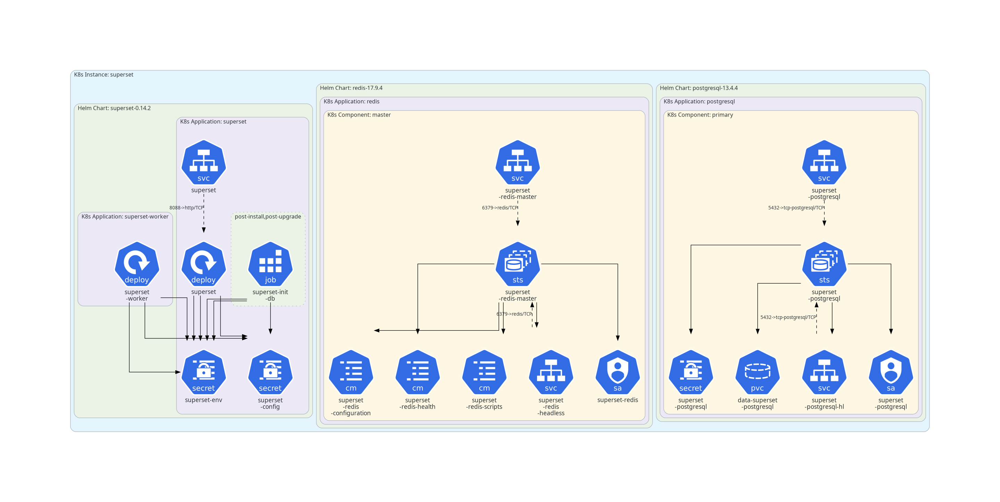

# Kubefix

Detect and correct architectural defects in Kubernetes manifests.
The defects and how Kubefix corrects them are explained in [docs/defects.md](./docs/defects.md).

## Example

Diagrams of the [Apache Superset](https://superset.apache.org/) Helm chart (`examples/superset-superset.yaml`), drawn with [KubeDiagrams](#generating-diagrams-with-kubediagrams).

**Before Kubefix:**



**After Kubefix:**



More before/after examples are in [diagrams.md](./diagrams.md).

## Installation

Requires Python 3.10 or later. You can install with either `pip` or [uv](https://docs.astral.sh/uv/).

**With pip**

```bash
python3 -m venv .venv
source .venv/bin/activate
pip install -e .
```

**With uv**

```bash
uv sync
```

`uv sync` creates the `.venv` and installs Kubefix and its dependencies in one step.

## Usage

```bash
kubefix <manifest.yaml> [OPTIONS]
```

With uv, either activate the environment (`source .venv/bin/activate`) or prefix commands with `uv run` (for example, `uv run kubefix examples/ex.yaml`).

By default, Kubefix prints the number of resources and labels changed by each algorithm, followed by the corrected manifest.

### Options

| Option | Description |
| --- | --- |
| `-o`, `--output FILE` | Write the corrected manifest to `FILE` instead of stdout. |
| `-s`, `--stats FILE` | Write a Markdown report of the summary of changes per algorithm to `FILE`. |
| `-c`, `--csv FILE` | Append the change statistics (one row per algorithm) to the CSV file `FILE`. |
| `--help` | Show all options. |

Options can be combined.

### Examples

```bash
# Print the corrected manifest
kubefix examples/ex.yaml

# Save the corrected manifest to a file
kubefix examples/ex.yaml -o fixed.yaml

# Save the corrected manifest and a Markdown stats report
kubefix examples/ex.yaml -o fixed.yaml -s stats.md

# Append stats to a CSV file (useful when processing many manifests)
kubefix examples/ex.yaml -o fixed.yaml -c stats.csv
```

## Running the tests

With uv:

```bash
uv run pytest
```

With pip:

```bash
pip install pytest
pytest
```

## Generating diagrams with KubeDiagrams

[KubeDiagrams](https://github.com/philippemerle/KubeDiagrams) can draw a manifest as an architecture diagram, which makes the changes made by Kubefix easy to see.

Install it in the same environment, along with [Graphviz](https://graphviz.org/download/):

```bash
pip install KubeDiagrams     # or: uv pip install KubeDiagrams
```

Then generate a diagram from a corrected manifest:

```bash
kube-diagrams fixed.yaml -o fixed.png
```

To draw the resources that Kubefix marked as isolated in a separate cluster, use the custom config `src/kubefix/kubefix.kdc`:

```bash
kube-diagrams fixed.yaml -o fixed.png -c src/kubefix/kubefix.kdc
```

### Before/after diagrams for the example manifests

`generate.sh` runs Kubefix on every manifest in `examples/` and draws the diagram before and after correction:

```bash
./generate.sh
```

The results are collected side by side in [diagrams.md](./diagrams.md).
